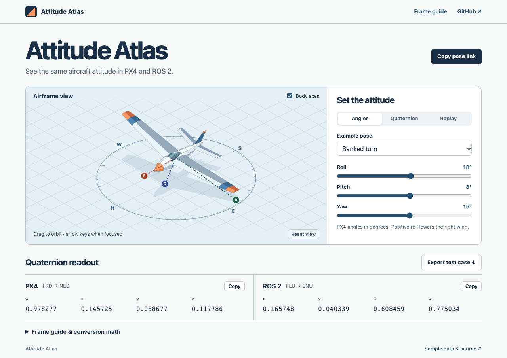

# Attitude Atlas

A visual quaternion debugger for PX4 and ROS 2. Paste an attitude from either system, see where the aircraft points, and export the equivalent pose as a regression test fixture.

**[Open the interactive workbench](https://lazyerzzz.github.io/attitude-atlas/)** · [中文说明](README.zh-CN.md) · [Try a north-facing pose](https://lazyerzzz.github.io/attitude-atlas/#q=1,0,0,0)

[](https://lazyerzzz.github.io/attitude-atlas/)

## A 30-second frame check

1. Select **Level, facing north**. PX4 reads `[1, 0, 0, 0]` in **w, x, y, z** order.
2. Look at the ROS 2 row. It reads `[0, 0, 0.707107, 0.707107]` in **x, y, z, w** order. Its yaw is +90° because geographic ENU yaw starts at east.
3. Switch to **Level, facing east**. Now the ROS quaternion is the identity. Drag the aircraft view to inspect the nose against the compass. Orbiting the camera keeps the attitude fixed.

## Use it during development

- **Inspect a message.** Choose Quaternion, select the source convention and paste four numbers. The viewer normalizes the input and displays both representations.
- **Replay recorded attitudes.** Open Replay to scrub the bundled PX4 excerpt or import a numeric, comma-separated `vehicle_attitude` CSV up to 16 MiB. Timestamps determine playback speed. Between samples the viewer holds the last recorded attitude.
- **Share a bug.** Copy pose link puts the four PX4 components in the URL fragment. Anyone who opens the link sees the same physical attitude. The link contains a single pose. Imported files are processed locally.
- **Test a bridge.** Export test case downloads JSON containing both quaternions, their component orders, frame names and the expected forward unit vector in each world frame. Compare rotations allowing for the equivalent signs of a unit quaternion.

To extract the attitude topic with [pyulog](https://github.com/PX4/pyulog), run:

```sh
ulog2csv -m vehicle_attitude flight.ulg
```

Open the resulting `*_vehicle_attitude_0.csv` in Replay. Required columns are `timestamp` in microseconds and `q[0]` through `q[3]`. Extra numeric columns and reordered headers are supported. [Download the example CSV](site/sample.csv).

## Frame conventions

| | Body axes | World axes | Quaternion order |
|---|---|---|---|
| PX4 vehicle attitude | Forward, right, down | North, east, down | w, x, y, z |
| ROS geographic local frame | Forward, left, up | East, north, up | x, y, z, w |

Each attitude maps a body vector into the world. With column vectors, the rotation matrices satisfy `R_ros = A · R_px4 · B`. The world basis change is `A(n,e,d) = (e,n,−d)`. The body basis change is `B(f,l,u) = (f,−l,−u)`. The sliders use PX4 intrinsic Z–Y–X yaw, pitch and roll, displayed in degrees. At vertical pitch, roll and yaw are coupled. The quaternion retains the full orientation. ROS systems with an arbitrarily oriented map or odometry frame require their own world-frame alignment.

References: [PX4 VehicleAttitude](https://docs.px4.io/main/en/msg_docs/VehicleAttitude), [PX4 frame transforms](https://github.com/PX4/px4_ros_com/blob/main/include/px4_ros_com/frame_transforms.h), [ROS REP 103](https://www.ros.org/reps/rep-0103.html).

## Run locally

The static site has no build step, runtime dependencies or remote assets.

```sh
python3 -m http.server 8000 --directory site
```

Open <http://localhost:8000>. Run the numerical tests with Node.js 18 or newer:

```sh
node --test tests/*.test.mjs
```

The tests cover cardinal headings, pitch singularities, quaternion normalization, CSV validation and sample timing. Every sample in the included recording is checked against an independent direction-cosine matrix.

## Sample data

The demo contains 187 attitude samples spanning 7.9992 seconds from the [PX4 pyulog test recording at revision 0b392f8](https://github.com/PX4/pyulog/blob/0b392f8444f843b796405b9766cc15a6dddedf62/test/sample.ulg). It takes every fourth `vehicle_attitude` sample in the first eight seconds of that topic and retains the original timestamp and quaternion. The aircraft drawing is illustrative. The recording's vehicle type and flight conditions are unspecified.

The application and original illustrations use the [MIT license](LICENSE). The bundled PX4 sample carries its [upstream BSD 3-Clause notice](site/SAMPLE-LICENSE.txt).
