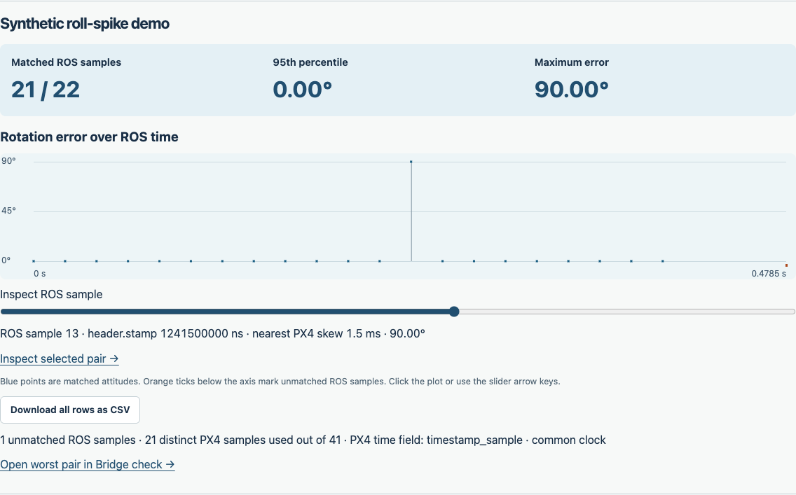

# Attitude Atlas · 无人机姿态坐标系工作台

把整段 PX4 和 ROS 2 姿态记录放进浏览器，找出两边从哪一帧开始不一致，再把那一对消息交给同事复现。

**[打开整段日志对比](https://lazyerzzz.github.io/attitude-atlas/logs.html)** · [核对一对消息](https://lazyerzzz.github.io/attitude-atlas/compare.html) · [单姿态工作台](https://lazyerzzz.github.io/attitude-atlas/) · [English](README.md)

[](https://lazyerzzz.github.io/attitude-atlas/logs.html)

## 从一段日志定位到一帧

内置合成示例有 22 条 ROS 样本。在 5 ms 时间窗内有 21 条匹配，最后一条超出时间窗。第 95 百分位显示为 0.00°，第 13 条却出现了 90° 滚转误差。点击最高点即可检查两架飞机的姿态，也可以复制带复现链接的 Markdown 报告。

1. 用 `ulog2csv -m vehicle_attitude flight.ulg` 导出 PX4 CSV。录制或回放 ROS bag 时，运行 `ros2 topic echo /odom --full-length > ros.yaml` 保存一个带时间戳的话题，按 Ctrl+C 结束。
2. 两份数据须分别符合 FRD → NED 和 FLU → 地理 ENU 的约定。确认使用同一时钟和时间原点，或输入同一物理时刻的两个已知读数（PX4 微秒、ROS 纳秒）。单个同步点仅校正常量偏移。时钟重启需分段处理。
3. 选择允许的最大配对时间差。页面为每条 ROS 消息寻找最近的 PX4 样本，等距时取较早样本。可检查覆盖率、复用的样本与误差峰值。导出 CSV 保留未匹配行、两侧原始时间戳以及对齐后的时间差。

浏览器在本地处理文件，每个文件上限 16 MiB。命令行支持 CSV，安装 pyulog 且 `ulog2csv` 在 PATH 中时也可以直接读取 `.ulg`。下面的命令运行内置样例：

```sh
node bin/check-recording.mjs site/samples/roll-spike.csv site/samples/roll-spike.yaml \
  --shared-clock --max-skew-ms 5 --rows-out rows.csv --case-out worst.json
```

可以用 `--max-error-deg 2 --min-coverage-pct 95` 设置回归条件。通过返回 0，超限或零匹配返回 1，输入或读写错误返回 2。不同时间原点可用 `--px4-anchor-us US --ros-anchor-ns NS` 替代 `--shared-clock`。输出文件使用新路径。

## 核对自己的两条消息

1. 在 Bridge check 的左右输入框分别粘贴 PX4 和 ROS 消息，点击 Compare attitudes。支持四个数值、JSON，以及单条 `ros2 topic echo --once` 的 YAML 输出。
2. 页面按 PX4 的 FRD → NED 和 ROS 的 FLU → 地理 ENU 进行转换。使用自定义 map、odom 或传感器安装坐标系时，先对齐参考系。输入原始模长和 ROS 帧名可在结果下方核对。
3. 只有确认两条消息共用时钟和时间原点时，才勾选时间复选框。偏移为 ROS 时间减 PX4 时间，单位毫秒。更换任一消息后需要重新确认。
4. 复制对比链接可以让同事复现同一对姿态。导出的 JSON 可重新打开，也可用于自动回归测试。分享内容包含提取的姿态、时间戳、帧名和时钟选择。

仓库附有一个可直接运行的回归案例：

```sh
node bin/check-case.mjs examples/north-roll.json --max-error-deg 1
```

本例中两架飞机机头朝向相同，滚转相差 90°，会超过 1° 容差并返回退出码 1。要检查新版本节点的输出，可追加 `--ros observed.yaml`。通过检查返回 0，数据或参数无效返回 2。

## 先试一个容易判断的姿态

打开 [水平朝北的示例](https://lazyerzzz.github.io/attitude-atlas/#q=1,0,0,0)。PX4 显示的四元数是 `[1, 0, 0, 0]`，ROS 2 显示 `[0, 0, 0.707107, 0.707107]`。在地理 ENU 坐标系里，零偏航指向东，朝北对应 +90°。再从 Example pose 里选 **Level, facing east**，这次 ROS 一侧会显示单位四元数。拖动视图可以换观察角度，右侧三个滑块可以改变飞机姿态。

| 数据来源 | 机体坐标系 | 世界坐标系 | 四元数顺序 |
|---|---|---|---|
| PX4 vehicle_attitude | 前、右、下 | 北、东、下 | w, x, y, z |
| ROS 2 地理局部坐标系 | 前、左、上 | 东、北、上 | x, y, z, w |

两行都表示从机体系到世界系的旋转。如果 ROS 的 map 或 odom 有自定义朝向，还需要使用实际的世界系对齐关系。

## 用自己的数据

- **Quaternion** 支持粘贴消息原文，或逗号和空格分隔的四个分量，先选输入约定，再点 Apply quaternion。
- **Replay** 可以播放内置的约八秒 PX4 姿态记录，也可以打开自己的 CSV。安装 pyulog 后，用 `ulog2csv -m vehicle_attitude flight.ulg` 导出，再打开生成的 `*_vehicle_attitude_0.csv`。需要微秒时间戳 `timestamp` 和 `q[0]` 至 `q[3]`，文件上限为 16 MiB。如果存在 pose_frame 列，每行均须明确为 NED（1）。可逐样本前后步进，并查看当前姿态已保持的时间。
- **Copy pose link** 生成可贴进 GitHub issue 的链接，包含当前姿态的四个分量。CSV 在本地浏览器处理。
- **Export test case** 下载 JSON，包含两套四元数、轴约定、分量顺序，以及机头单位向量在两个世界系里的期望值。

## 本地运行

仓库根目录运行 `python3 -m http.server 8000 --directory site`，然后访问 <http://localhost:8000>。使用 Node.js 18 或更高版本运行 `node --test tests/*.test.mjs` 即可验证转换。

[示例数据来源和授权](README.md#sample-data) · [PX4 坐标转换实现](https://github.com/PX4/px4_ros_com/blob/main/include/px4_ros_com/frame_transforms.h) · [ROS REP 103](https://www.ros.org/reps/rep-0103.html)
