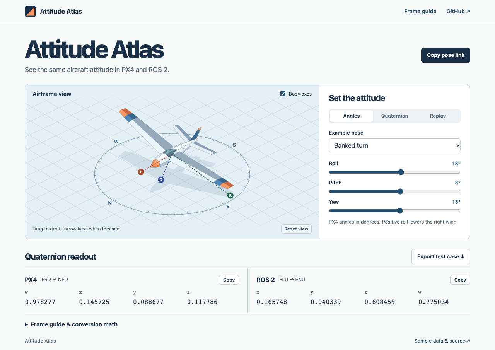

# Attitude Atlas · 无人机姿态坐标系工作台

把 PX4 或 ROS 2 消息里的四元数贴进浏览器，就能看到机头、右翼和机腹的朝向，以及同一姿态在另一个坐标系里的四元数。适合联调姿态可视化、排查坐标轴符号，以及给坐标转换代码做回归测试。

**[打开在线工具](https://lazyerzzz.github.io/attitude-atlas/)** · [English](README.md)

## 先试一个容易判断的姿态

打开 [水平朝北的示例](https://lazyerzzz.github.io/attitude-atlas/#q=1,0,0,0)。PX4 显示的四元数是 `[1, 0, 0, 0]`，ROS 2 显示 `[0, 0, 0.707107, 0.707107]`。在地理 ENU 坐标系里，零偏航指向东，朝北对应 +90°。再从 Example pose 里选 **Level, facing east**，这次 ROS 一侧会显示单位四元数。拖动视图可以换观察角度，右侧三个滑块可以改变飞机姿态。

| 数据来源 | 机体坐标系 | 世界坐标系 | 四元数顺序 |
|---|---|---|---|
| PX4 vehicle_attitude | 前、右、下 | 北、东、下 | w, x, y, z |
| ROS 2 地理局部坐标系 | 前、左、上 | 东、北、上 | x, y, z, w |

两行都表示从机体系到世界系的旋转。如果 ROS 的 map 或 odom 有自定义朝向，还需要使用实际的世界系对齐关系。

## 用自己的数据

- **Quaternion** 支持粘贴逗号或空格分隔的四个分量，先选输入约定，再点 Apply quaternion。
- **Replay** 可以播放内置的约八秒 PX4 姿态记录，也可以打开自己的 CSV。安装 pyulog 后，用 `ulog2csv -m vehicle_attitude flight.ulg` 导出，再打开生成的 `*_vehicle_attitude_0.csv`。需要微秒时间戳 `timestamp` 和 `q[0]` 至 `q[3]`，文件上限为 16 MiB。
- **Copy pose link** 生成可贴进 GitHub issue 的链接，包含当前姿态的四个分量。CSV 在本地浏览器处理。
- **Export test case** 下载 JSON，包含两套四元数、轴约定、分量顺序，以及机头单位向量在两个世界系里的期望值。

## 本地运行

仓库根目录运行 `python3 -m http.server 8000 --directory site`，然后访问 <http://localhost:8000>。使用 Node.js 18 或更高版本运行 `node --test tests/*.test.mjs` 即可验证转换。

[示例数据来源和授权](README.md#sample-data) · [PX4 坐标转换实现](https://github.com/PX4/px4_ros_com/blob/main/include/px4_ros_com/frame_transforms.h) · [ROS REP 103](https://www.ros.org/reps/rep-0103.html)
